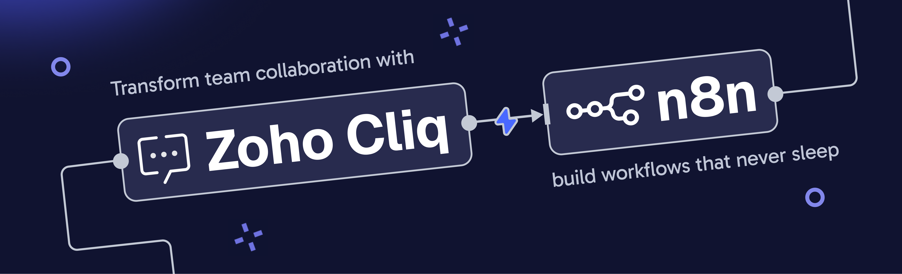

# 🚀 Zoho Cliq Integration with n8n  

Zoho Cliq is a powerful team communication and collaboration tool that simplifies workplace conversations, automates workflows, and helps teams stay connected.  
The **n8n integration with Zoho Cliq** enables you to automate actions such as sending messages, managing channels, and creating threads — allowing seamless communication between your business tools.

🔗 **Learn more:**  
- [n8n Homepage](https://n8n.io/)  
- [Zoho Cliq Homepage](https://www.zoho.com/cliq/)  
- [Zoho Cliq Rest API](https://www.zoho.com/cliq/help/restapi/v2/)

---

## 🧩 Pre-requisites  

Before you start, ensure you have:  
- A valid **n8n admin login account** → [https://app.n8n.cloud/login](https://app.n8n.cloud/login)  
- An active **Zoho Cliq account**  

---

## ⚙️ Installation  

You can install the Zoho Cliq community node in n8n using [npm](https://www.npmjs.com/):  

**Package name:** `n8n-nodes-zohocliq`  

**To install:**  
1. Log in to your **n8n** account.  
2. Navigate to **More options → Settings → Community Nodes → Install.**  
3. Enter the package name `n8n-nodes-zohocliq`.  
4. Click **Install** to add it to your workspace.  

---

## 🔐 Configuration  

Follow these steps to connect your Zoho Cliq account with n8n:  

1. Log in to your **n8n** account.  
2. Navigate to **Credentials → Add Credential → Zoho Cliq OAuth2 API → Continue.**  
3. Copy the **Authorized Redirect URL** shown in n8n.  
4. Visit the [Zoho Developer Console](https://api-console.zoho.com/) and create a new client:  
   - Click **Add Client** → choose **Server-based Applications**.  
   - Enter a **Client Name**, your **Homepage URL**, and paste the **Authorized Redirect URL**.  
5. Click **Create** to generate your **Client ID** and **Client Secret**.  
6. Go back to n8n → enter these credentials → click **Connect my account**.  
7. Once connected, you can start building workflows using Zoho Cliq actions and triggers.  

---

## ⚡ Supported Actions  

| Category | Action | Description |
|-----------|---------|-------------|
| **Channels** | Add bot to channel | Add your bot to a specific channel |
|  | Add channel members | Add users to a channel |
|  | Archive channel | Archive a channel |
|  | Create channel | Create a new channel |
|  | Delete channel | Delete an existing channel |
|  | Fetch channel | Retrieve details of a specific channel |
|  | Remove channel members | Remove a user from a channel |
|  | Unarchive channel | Restore an archived channel |
|  | Update channel | Modify the details of a channel |
| **Messages** | Post message to channel | Send a message to a specific channel |
|  | Post message to channel as bot | Send a message to a channel as a bot |
|  | Post message to chat | Send a message to a one-on-one or group chat |
|  | Post message to user chat | Send a direct message to a user | 
|  | Pin message | Pin a message in a channel |
| **Teams** | Fetch team | Retrieve information about a team |
| **Threads** | Create a thread | Create a new thread inside a channel |
|  | Update thread state | Close or reopen a thread |
| **Users** | Add user status | Add a custom status for a user |
|  | Retrieve user data | Get details of a specific user |
|  | Set user status | Update or modify a user’s status |

---

## 🧠 Example Workflow  

1. Click **Create Workflow → Add First Step → Search “Zoho Cliq.”**  
2. Choose a Zoho Cliq node (e.g., *Post Message to Channel*).  
3. Configure inputs such as **channel ID**, **message content**, or **bot ID**.  
4. Connect subsequent nodes from other apps to trigger actions dynamically.  
5. Click **Test Workflow** to validate your setup.  

---

## 🧰 Troubleshooting  

If you face any issues while configuring or running your Zoho Cliq workflows in n8n, please contact:  
📧 **[support@zohocliq.com](mailto:support@zohocliq.com)**  

---

## 📝 Description  

This document explains how to integrate **Zoho Cliq** with **n8n**, enabling automation of collaboration and communication tasks.  
You can automate posting messages, managing channels, updating threads, and syncing statuses between your favorite tools using n8n’s visual workflow builder.  

🔗 More info: [https://www.zoho.com/cliq/](https://www.zoho.com/cliq/)  

---
